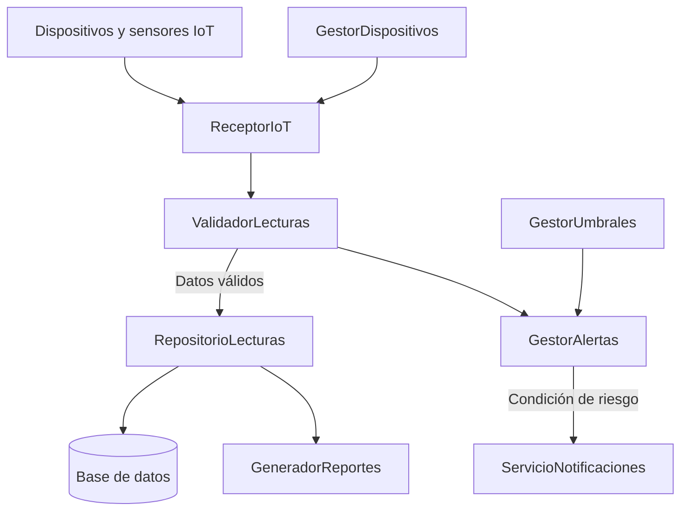

# Diagrama del diseño mejorado de ColdSense

La propuesta distribuye las responsabilidades en componentes independientes para facilitar el mantenimiento, las pruebas y la incorporación de nuevas funciones.

## Beneficios del diseño mejorado

- Cada componente tiene una responsabilidad específica.
- La validación está separada del almacenamiento y de las reglas de alertas.
- Las notificaciones pueden modificarse sin cambiar las reglas que detectan riesgos.
- El historial puede utilizarse para generar reportes.
- Los componentes pueden probarse de forma independiente.

Este diagrama representa una propuesta conceptual; no implica que los componentes estén implementados o conectados a dispositivos físicos.
