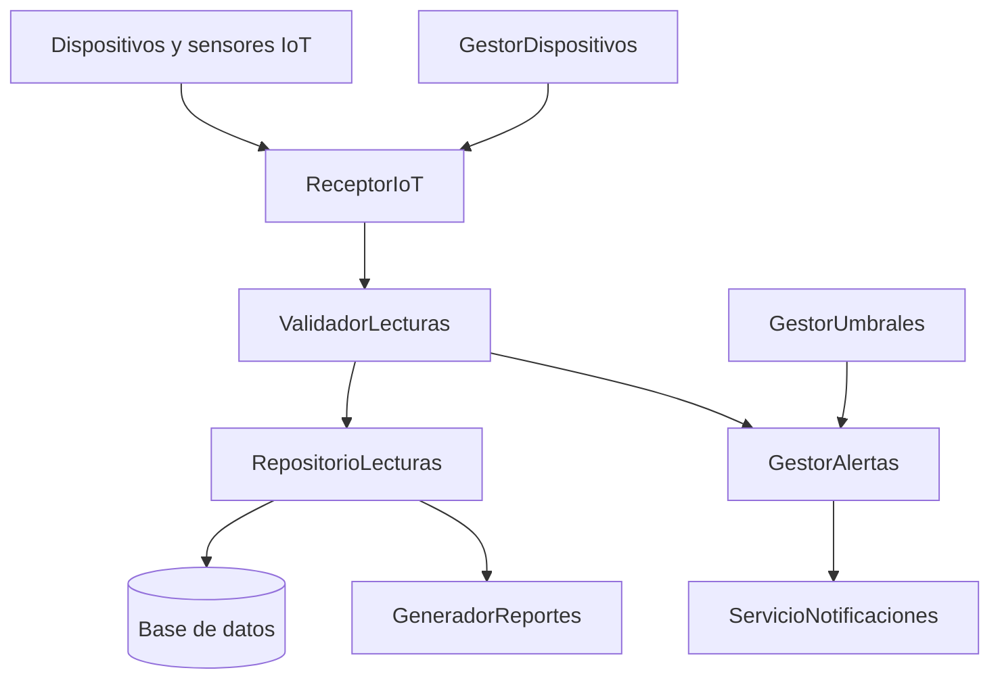

# Diagrama del diseño mejorado de ColdSense

La propuesta divide las responsabilidades en componentes independientes que colaboran entre sí.

## Beneficios del diseño mejorado

- Cada componente tiene una responsabilidad específica.
- El almacenamiento se encuentra separado de la lógica de alertas.
- Las notificaciones pueden cambiarse sin modificar las reglas que detectan condiciones de riesgo.
- Los componentes pueden probarse de manera independiente.
- Se facilita la incorporación de nuevos sensores y funciones.
