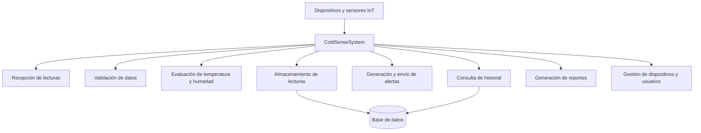

# Diagrama del diseño original de ColdSense

El diseño inicial propuesto concentra las responsabilidades principales en una sola clase. Esto genera una dependencia elevada entre las funciones.

## Observación

La clase principal concentra demasiadas funciones. Si cambia la base de datos, la forma de enviar alertas o la generación de reportes, puede ser necesario modificar el mismo componente.
